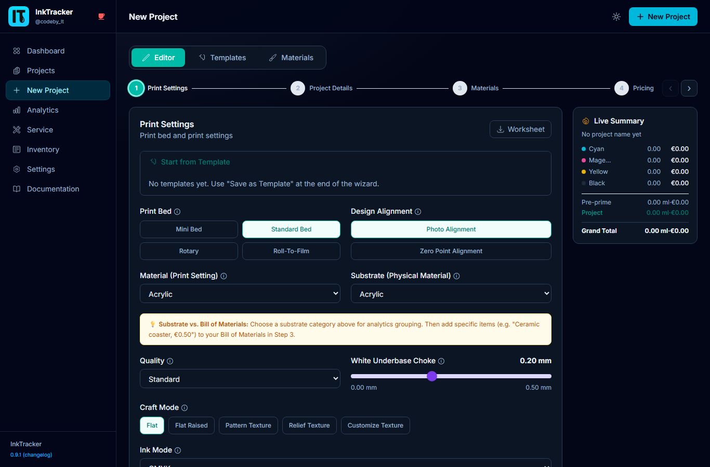
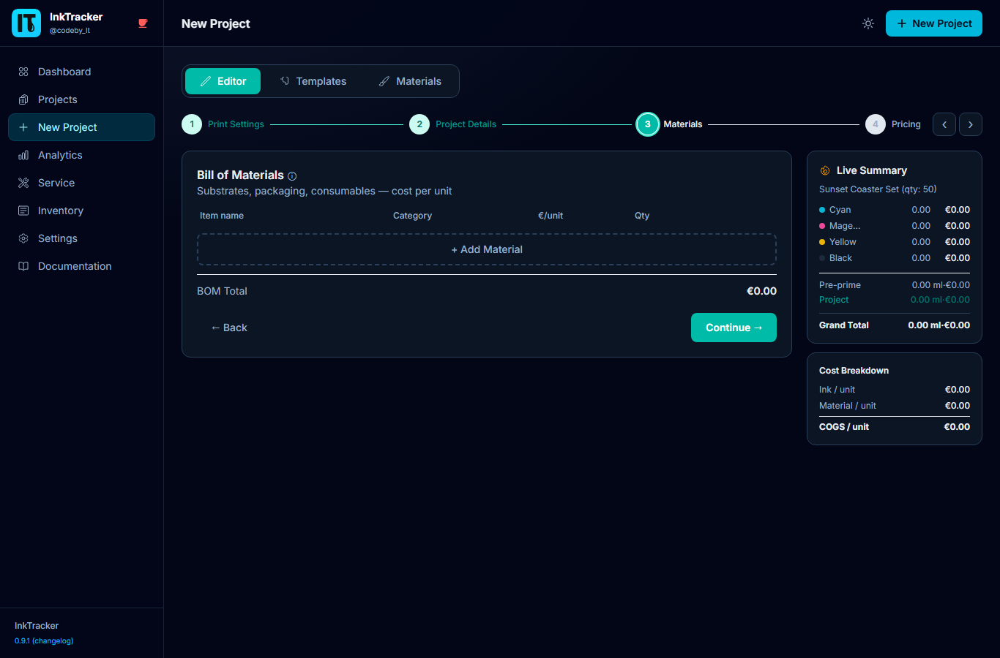
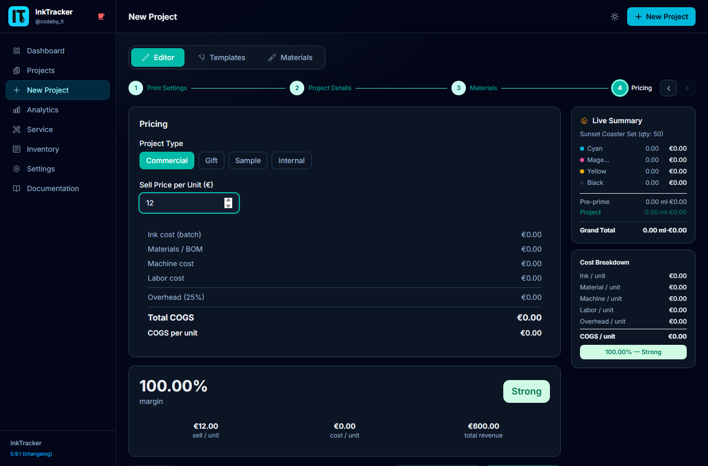
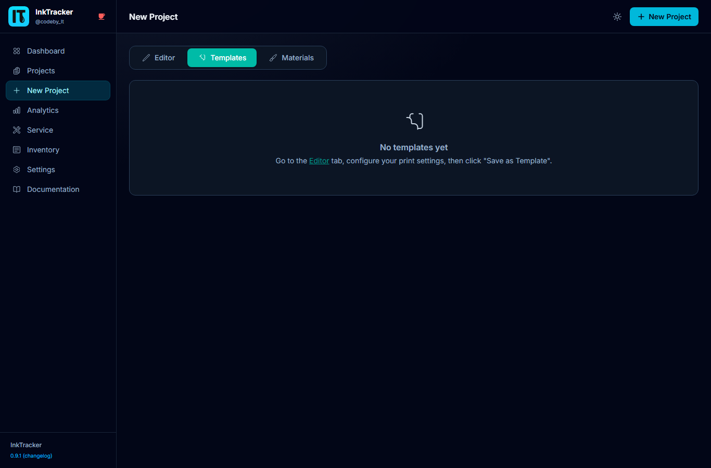
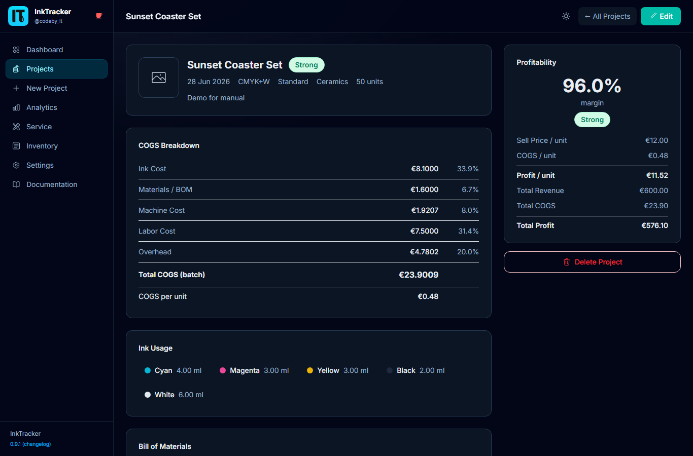
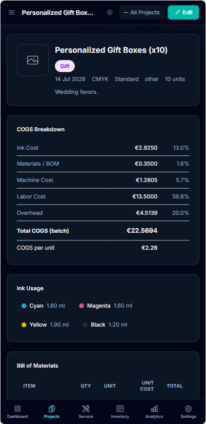

# 3. Creating a Project

The **New Project** wizard walks you through pricing a job from start to finish. By the
end, you'll have a full cost breakdown and a recommended price with a profit margin.

Open it from **New Project** in the menu. The wizard has three tabs across the top:
**Editor**, **Templates**, and **Materials**.

---

## The Editor tab (4 steps)

### Step 1 - Print settings
Choose how the piece is printed: ink mode, alignment, and ink usage per color channel.

**Quality** follows the saved **Printer Profile** under
[Settings > Machine](08-settings.md): eufyMake offers **Draft**, **Standard**, and
**High**; **Other / Custom** also offers **Ultra**.
Editing an existing project also retains its saved quality if it is outside the
current profile's list.

**Multiple craft faces:** If **Multiple craft modes** is turned on (in **Settings >
Preferences > Features** - on by default), you can add more than one **craft face** to a
single project, each with its own print mode and ink usage. Handy for double-sided or
multi-part pieces.

Turning this feature off hides the multi-craft controls; it does not delete saved
faces. Existing faces remain part of the project's consumption and cost totals.

Preview and worksheet totals sum every enabled face using each channel's cartridge
price and capacity. Only channels visible for a face's selected mode are saved.
Color Raised textures include CMYK, loaded White/Flex White, and Gloss.

### Step 2 - Details
Enter the **name**, quantity, notes, and any project details.

Pre-prime is a display-only estimate, excluded from saved consumption and COGS.
Enter the actual ink totals reported by your printer software.

### Step 3 - Materials (BOM)
Add the materials used (your "bill of materials"). Pick from your **Materials Library**
or type items in. Each line adds its cost to the total.

**Item name** suggests names from the library. An exact name match (ignoring case
and surrounding spaces) prefills unit cost, unit, and category when you leave the
field or confirm the change.

- **Existing library item:** saving the project automatically records its stock
  consumption, even if **Save new items to my Materials library** is unchecked.
- **New free-text item:** contributes to costing without tracking library stock
  unless you enable **Save new items to my Materials library**. That option creates
  missing library entries on save and tracks their consumption for this project.
- **On edit:** stock changes reconcile against recorded automatic movements.
  Removing an old free-text item that never consumed stock does not create a refund;
  manual adjustments remain separate.

Do not also record a manual OUT movement for stock the project has already consumed.
Check the [Inventory movement logs](06-inventory.md) if unsure. A BOM item matching
the project's substrate is tracked through the substrate's project-unit consumption,
not counted a second time as BOM stock.

A zero quantity remains zero when saved and consumes no stock.

### Step 4 - Pricing
See the full **COGS breakdown** (ink + materials + machine + labor + overhead), set
your sell price, and watch the **margin badge** update live.

Click **Save** to create the project.

## The Templates tab

Apply a saved **print template** to fill settings instantly, so repeat jobs take
seconds. You can save the current settings as a new template too.

## The Materials tab

Browse and manage your reusable **Materials Library** without leaving the wizard.

## Print a worksheet

After saving, you can print a clean **worksheet** for the shop floor with the job's
settings, ink, and materials.

📱 On mobile

**Note:** Prices come from your **Settings**. If your numbers look off, check ink
costs, labor, and overhead there first.

---

Next: **[Managing Projects ->](04-projects.md)**
