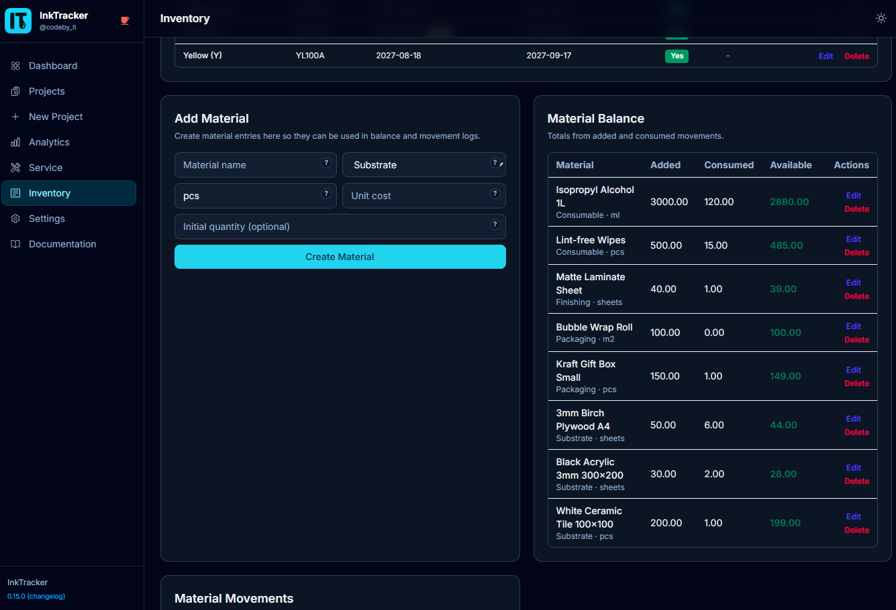
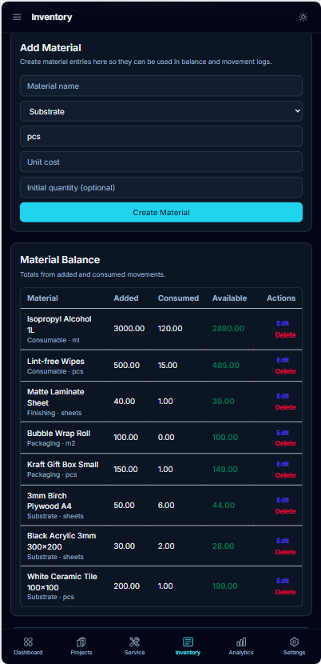
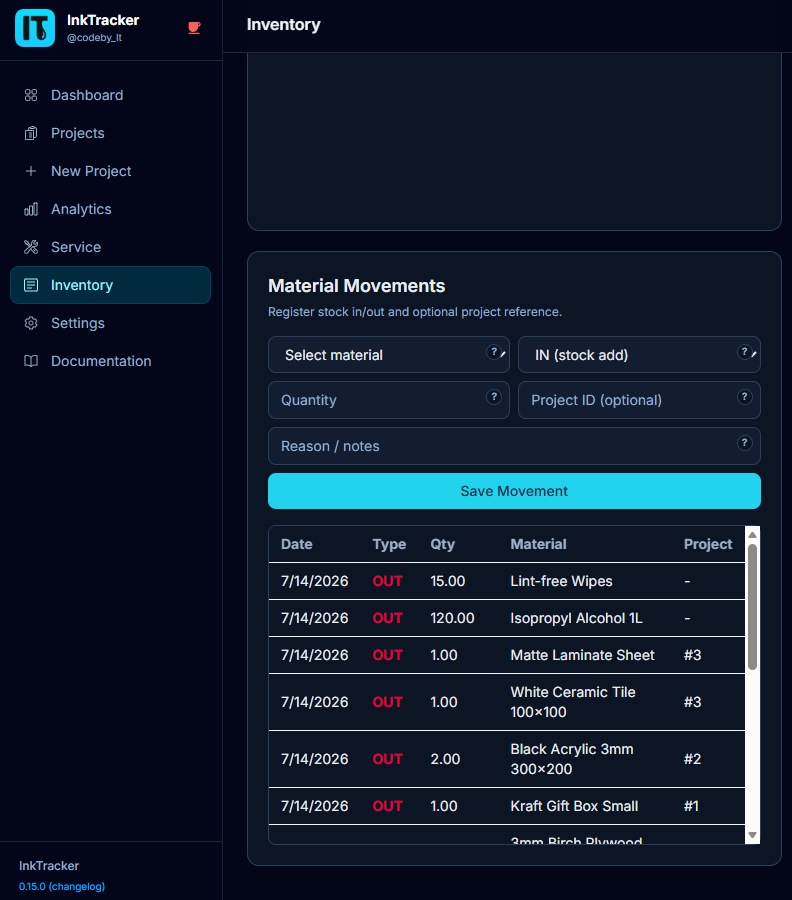
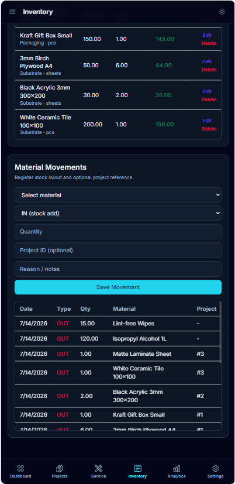
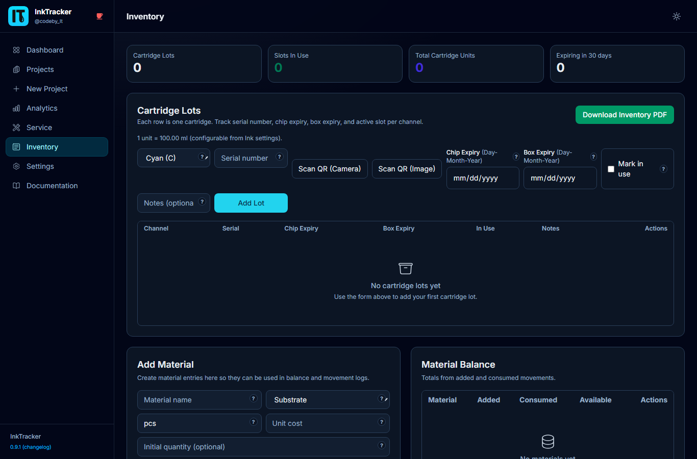
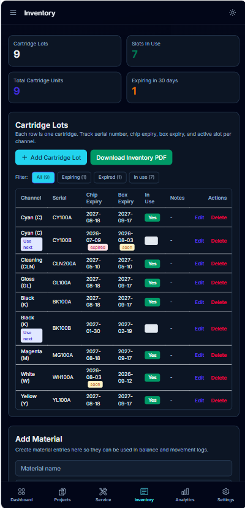

# 6. Inventory

The **Inventory** page tracks what you have on hand: project **materials** and ink
**cartridge stock**. Keeping it current means you never run out mid-job.

---

## Materials
Track your material items and their stock movements:

- **Add an item** — name, category, and cost per unit.
- **Record movements** — log stock coming in or going out to keep counts accurate.

The [project wizard's BOM](03-new-project-wizard.md) links items to this library by
name (case-insensitive, with surrounding spaces ignored). Matching existing items
consumes stock when the project is saved, regardless of the **Save new items to my
Materials library** option. That option creates entries for previously unknown
names; leave it off for free-text costing without library stock tracking.

📱 On mobile

### Movement logs
Every stock change is recorded as a **movement** (IN or OUT), optionally tied to a
project, so your available counts always add up and you can see where stock went.

Project saves automatically record consumption for matching library items. **Do not
record the same OUT movement manually**, or stock will be deducted twice. Manual
movements are for separate receipts, usage, and adjustments.

Editing a project compares its new substrate/BOM demand with its recorded automatic
movements and logs only the difference (OUT for more consumption, IN for a reduction).
Manual adjustments, even those linked to the project, remain separate. Removing an
old unlinked free-text item cannot refund stock that was never consumed.
Zero-quantity BOM lines consume no stock. If a BOM name also matches the project's
substrate, it is not deducted twice: substrate demand uses the project units.

📱 On mobile

## Cartridge lots
Track sealed cartridges you've bought:

- **Add a lot** — record a batch of cartridges in stock.
- **Mark "in use"** — flag a lot as the one currently installed.
- **Adjust quantity** — update counts as you open or restock.

Each new lot uses its channel's configured capacity, including the separate cleaning
and moisturizing compartments. Adding a lot already marked in use resets that
channel's consumption baseline, just like installing an existing spare. Adding a
spare does not reset levels. Material names match literally and case-insensitively:
`%` and `_` do not match other items.

📱 On mobile

## Download a report
Click **Report (PDF)** to export a printable stock summary for your records.

💡 **Tip:** Group and filter the materials table to find low items quickly, then top up
before a busy week.

---

Next: **[Analytics →](07-analytics.md)**
